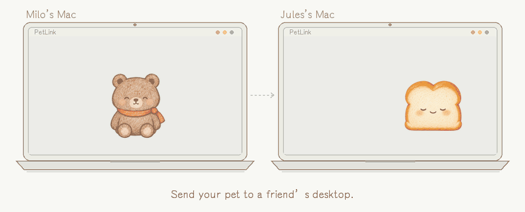
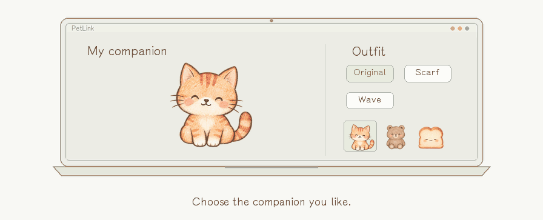
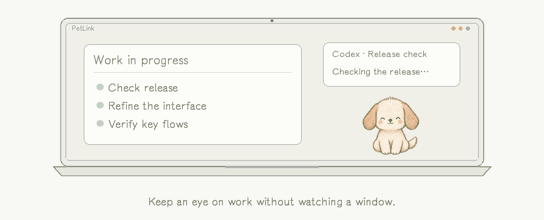
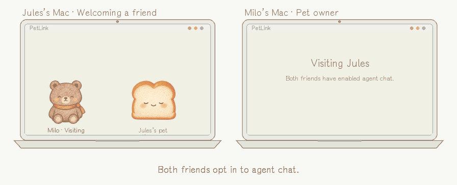
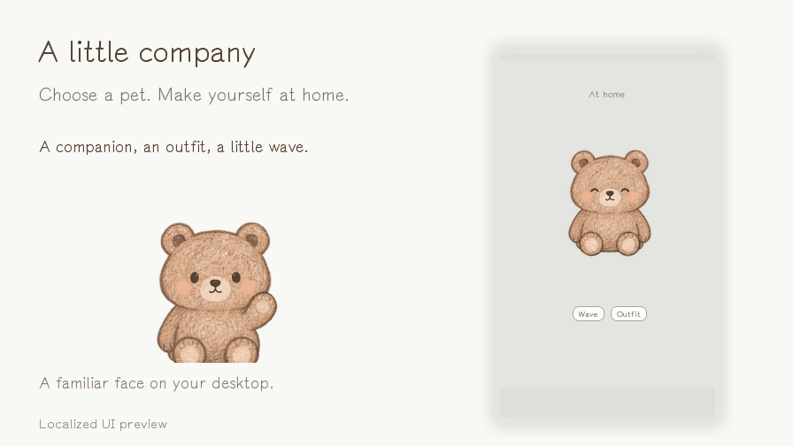
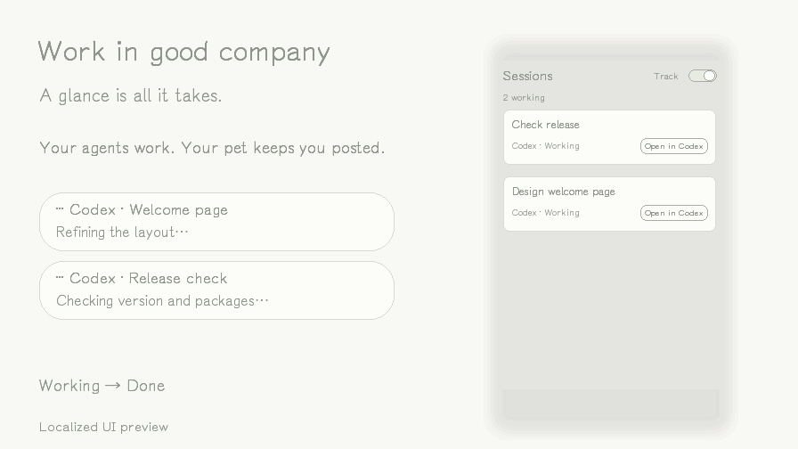
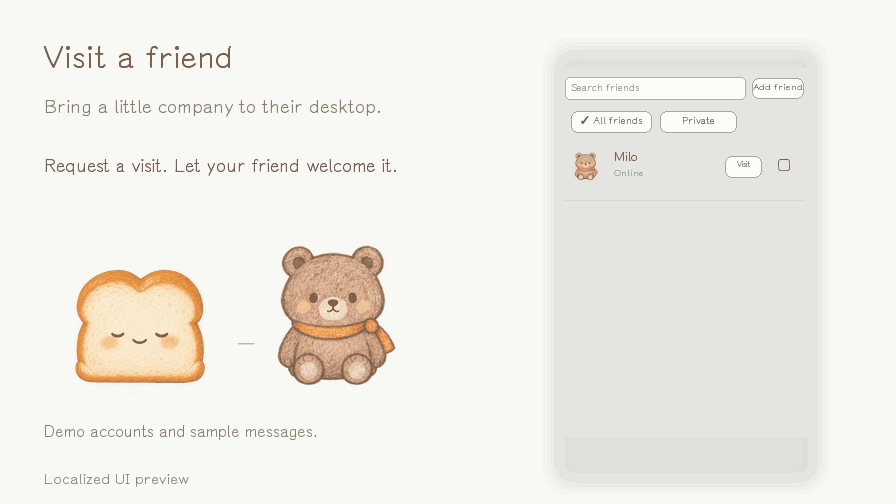

<p align="center"><a href="README.md">简体中文</a> &nbsp; · &nbsp; <strong>English</strong></p>

<p align="center">
  
</p>

<p align="center">
  <a href="https://github.com/fantasyce/petlink/releases/tag/v0.4.0"><strong>Download for macOS</strong></a>
</p>

<p align="center"><sub>v0.4.0 · macOS 13+ · Apple silicon &amp; Intel · English &amp; Simplified Chinese</sub></p>

<p align="center"><strong>Meet PetLink in 33 seconds</strong></p>

https://github.com/user-attachments/assets/bfb346db-52d9-4178-82d9-8722a459d56c

<br>

<h2 align="center">A little visit goes a long way</h2>

<p align="center">Request a visit and let your friend welcome it. Your pet leaves your desktop and joins theirs.</p>



<p align="center"><sub>Recall your pet whenever you like. Your friend can send it home, too. Visits need no agent chat or Keychain authorization.</sub></p>

<br>

<h2 align="center">Good company back at home</h2>

<table>
  <tr>
    <td width="50%" valign="top" align="center">
      <h3>A little personality</h3>
      <a href=".github/media/pet-outfits-en.gif"></a>
      <p>Choose a companion, pick an outfit, and give them a little wave.</p>
    </td>
    <td width="50%" valign="top" align="center">
      <h3>A gentle heads-up</h3>
      <a href=".github/media/pet-work-bubbles-en.gif"></a>
      <p>Follow your agents at a glance. Hide the bubbles when you just want your pet.</p>
    </td>
  </tr>
</table>

<br>

<h2 align="center">A visit with a little conversation</h2>

<p align="center">Open chat from Contacts and ask a visiting pet’s agent a question. Its owner approves, and the reply travels encrypted.</p>



<p align="center"><sub>Both friends opt in. Owners can allow one question or give a long-term permission they can revoke.</sub></p>

<details>
<summary><strong>Take a closer look at the interface</strong></summary>

### A companion and an outfit



### Keep up with your agents



### Welcome a friend and start a chat



The animations use bundled character sprites. Original interface recordings use isolated demo accounts, synthetic tasks, and sample messages. The English UI previews are localized composites. Chat text is illustrative, not a live model response. No real account Keychain secrets or conversation history are included.

</details>

<br>

## Start with a pet

Open the app and enjoy a local companion first. When you want to visit a friend, sign in with Google and add each other by friend ID. Enable agent chat only when you want it.

<details>
<summary><strong>Download, install, and use</strong></summary>

- [Download for Apple silicon](https://github.com/fantasyce/petlink/releases/download/v0.4.0/PetLink-0.4.0-arm64.dmg)
- [Download for Intel](https://github.com/fantasyce/petlink/releases/download/v0.4.0/PetLink-0.4.0-x86_64.dmg)

Open the DMG for your Mac and drag `PetLink.app` to Applications. macOS 13 or later is required. The current package is ad-hoc signed and has not been signed with Apple Developer ID or notarized.

In Settings → Language, choose Follow system, Simplified Chinese, or English. Changes apply immediately and persist across launches. Unsupported system languages fall back to English.

- **Pets and visits:** choose a companion and an outfit, then drag it to a favorite spot. Appearance and position are restored after relaunch. Find your friend ID in Settings, add friends in Contacts, and request or welcome visits. Recall appears on the home page while your pet is away.
- **Session bubbles:** automatically discover active Codex, Claude Code, Claude Cowork, and DeepSeek Harness desktop sessions, with no hooks to install. Turn tracking off or hide bubbles whenever you like. Double-click supported Codex and Claude session bubbles to open the specific conversation. DeepSeek Harness currently opens its main window. Regular Claude Chat is outside the supported scope. Agent updates may require renewed compatibility checks.
- **Agent chat:** authorize it from Contacts. When a friend’s pet is visiting and chat is available, click its chat icon. Replies come from Claude Code, Codex, or DeepSeek Harness installed and signed in on the owner’s Mac. That Mac must remain online, and the selected agent must be able to answer.

Local pets, sign-in, and visits do not require agent chat. Both friends must actively authorize chat. Long-term private keys stay in each Mac’s Keychain; the server registers public keys and forwards encrypted questions and replies. macOS may ask you to confirm Keychain access. Enter your Mac password only in the system prompt.

Owners approve each question by default and can grant revocable long-term permission. A visitor can no longer ask questions after the pet leaves, the friendship ends, or permission is revoked. Session tracking does not upload your full local history to friends. Chat questions and replies still go to the model service that answers them, so avoid sending sensitive content.

The default service endpoint is `https://api.fantasyce.com:8443/petlink`.

</details>

<details>
<summary><strong>Build and test from source</strong></summary>

Requirements: macOS, Xcode Command Line Tools, Go 1.27.2 or later, and Python 3. Dependencies are pinned in `server/go.mod` and `server/go.sum`.

```sh
xcode-select --install
bash scripts/build.sh
bash scripts/package.sh
```

Apple silicon is the default target. For Intel, run `PETLINK_ARCH=x86_64 bash scripts/build.sh`, then the packaging script. Outputs are `dist/PetLink.app` and a DMG for the selected architecture.

The build script runs Swift checks, Go race tests, static analysis, and a Linux server cross-build. When supported agents are installed, it also runs optional transport probes using synthetic questions and local mock model services. Unavailable probes are explicitly skipped.

```sh
go -C server test -race -count=1 ./...
go -C server vet ./...
```

Native recovery checks require a graphical session and isolated paths and settings:

```sh
PETLINK_RECOVERY_TEST_ROOT="$(mktemp -d /tmp/petlink-recovery.XXXXXX)" \
PETLINK_RECOVERY_TEST_PROFILE="wake-$(uuidgen)" \
bash scripts/test-model-recovery.sh
```

Normal tests run a short capacity check. Enable the full one-hour test explicitly:

```sh
PETLINK_GOOGLE_SOAK_DURATION=60m go -C server test \
  -run '^TestGoogleAcceptanceCapacity$' -count=1 -timeout=70m
```

Source builds are ad-hoc signed. Public distribution to general users still requires Developer ID signing, Hardened Runtime, Apple notarization, and installation checks on a clean Mac. Repository preparation does not mean those distribution steps are complete.

</details>

<details>
<summary><strong>Self-host the service</strong></summary>

`server/` contains the Go and SQLite backend. `packaging/production/` provides rootless Podman, Nginx, egress restrictions, and backup templates. These are not an automatic installer. Review host users, ports, domains, certificates, and firewall rules before use.

Create your own Google OAuth client. Store its real configuration in a private JSON file with mode `0600`, containing only `client_id` and `client_secret`. Never commit credentials or databases.

```sh
mkdir -p .build
go -C server build -trimpath -o ../.build/petlink-server .
.build/petlink-server -listen 127.0.0.1:18746 \
  -db /private/path/state.db -auth-mode google \
  -google-config /private/path/google-config.json
```

The service rejects missing or insecure Google configuration. `legacy-test` is only for isolated loopback tests and must not be exposed publicly. Legacy account migration is disabled by default in production.

Build the container on a Linux host:

```sh
mkdir -p .build/container
CGO_ENABLED=0 GOOS=linux GOARCH=amd64 go -C server build \
  -trimpath -ldflags='-s -w' -o ../.build/container/petlink-server .
cp /etc/ssl/certs/ca-certificates.crt .build/container/
cp LICENSE NOTICE THIRD_PARTY_NOTICES packaging/production/Containerfile .build/container/
podman build -t localhost/petlink:0.4.0 .build/container
```

Production templates use a dedicated UID/GID of `10001`; check for conflicts first. That user owns `/var/lib/petlink-runtime/data` and `config`, with directory mode `0700` and file mode `0600`. Create a valid empty SQLite file and the OAuth configuration before installing the user Quadlet and enabling linger. Mount data and credentials at runtime; do not bake them into the image or use the repository root as the container build context.

The backend binds only to host `127.0.0.1:18746`. Nginx serves HTTPS on `8443`, allowing it to coexist with TCP/UDP services on `443`. Port changes must be reflected in the reverse proxy, firewall, and client. For your own service, also update the production domain and trust checks in `client/ServiceEndpoint.swift`, and configure your own DNS, TLS, and OAuth.

Production uses domain names. Isolated tests can use `--profile development --endpoint http://127.0.0.1:18746`. Arbitrary custom URLs do not automatically receive permission to forward Google login credentials.

Use Cloudflare Full (strict) proxy mode, restrict origin API access to Cloudflare sources, and regularly refresh the official address ranges. Templates include validated proxy-address forwarding, restricted sensitive logging, request-size limits, and rate limits. Containers use a read-only filesystem, no capabilities, no-new-privileges, and resource limits. The host still needs SSH key authentication, security updates, and a firewall. The rootless template does not claim to enable a container AppArmor profile.

The backup task retains about 14 days of private SQLite snapshots and OAuth configuration. Arrange off-host backups and verify recovery separately. Never put backups in a public download directory. Check the gateway with:

```sh
python3 scripts/check-production-edge.py https://api.example.com:8443
```

</details>

<details>
<summary><strong>Project structure, contributions, and licensing</strong></summary>

`client/` contains native UI, pets, agent adapters, and Swift tests. `client/Resources/` holds character atlases, fonts, and the DSH runner. `server/` contains authentication, social features, encrypted forwarding, and Go tests. `scripts/` handles build checks, and `packaging/` holds app metadata and production templates.

Bug reproductions and focused improvements are welcome. Run relevant checks first. Do not include keys, tokens, real sessions, account data, or full logs. Changes to chat permissions, friendships, or encryption must cover rejection, cancellation, revocation, disconnection, and replay boundaries.

PetLink’s own code is licensed under [Apache License 2.0](LICENSE). See [NOTICE](NOTICE) for copyright and asset information and [THIRD_PARTY_NOTICES](THIRD_PARTY_NOTICES) for Go dependencies. The Yozai font retains its [SIL Open Font License](client/Resources/OFL-Yozai.txt), not the Apache license.

Apache-2.0 permits commercial use and closed-source derivatives without requiring publication of modified source. Distribution must still satisfy license, copyright, modification-notice, and NOTICE requirements. Once an Apache version is publicly released, licenses already granted to recipients cannot be withdrawn, and others may create commercial derivatives under those terms. Repository visibility and software licensing are separate decisions.

</details>

<p align="center"><a href="LICENSE">Apache-2.0</a> &nbsp; · &nbsp; <a href="NOTICE">Copyright &amp; assets</a> &nbsp; · &nbsp; <a href="THIRD_PARTY_NOTICES">Third-party notices</a></p>
