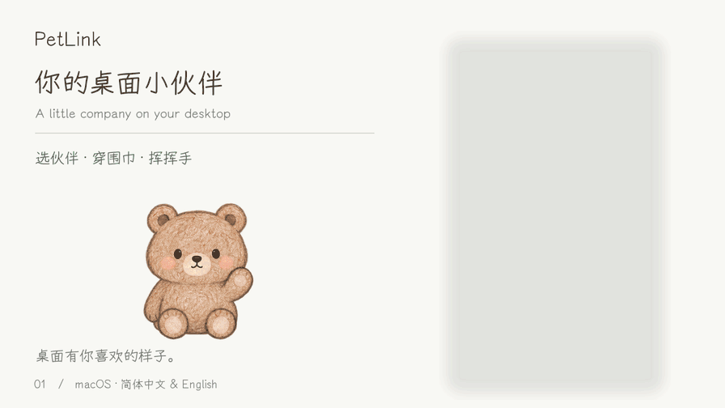
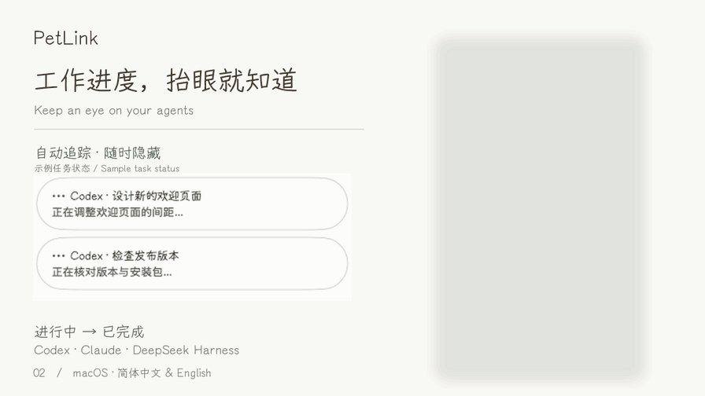
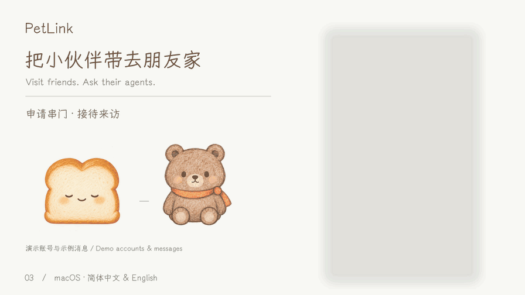

# PetLink

让桌面，多一点陪伴。 / A little company on your desktop.



**[下载 0.4.0 / Download](https://github.com/fantasyce/petlink/releases/tag/v0.4.0)** · **[观看 29 秒演示 / Watch the demo](.github/media/petlink-demo.mp4)**

macOS 13+ · Apple Silicon & Intel · 简体中文 / English

### 工作进度，抬眼就知道 / Keep an eye on your agents



### 去朋友家串门，也聊聊他们的 Agent / Visit friends and ask their agents



*演示账号与示例内容 / Demo accounts and sample content.*

<details>
<summary>安装与使用 / Installation & use</summary>

将对应架构的 DMG 打开，把 `PetLink.app` 拖入 Applications，要求 macOS 13 或更高版本。当前安装包使用本地 ad-hoc 签名，尚未完成 Apple Developer ID 签名与公证。

Open the DMG for your Mac and drag `PetLink.app` to Applications. macOS 13 or later is required. The current build is ad-hoc signed and has not been notarized by Apple.

界面支持简体中文和 English，在“设置 → 语言”选择跟随系统或指定语言，立即生效并记住选择。不支持的系统语言使用 English。

In Settings → Language, choose Follow system, 简体中文, or English. Changes apply immediately and persist across launches; unsupported system languages fall back to English.

- 选择桌宠和装扮，拖动到喜欢的位置；重启后恢复外观与位置。
- 通过 Google 登录，用好友 ID 添加联系人，申请串门、接待访客、挥手和召回。
- 自动识别 Codex、Claude Code、Claude Cowork 和 DeepSeek Harness 桌面版的活跃会话，用气泡显示进度；可以关闭追踪或隐藏气泡，无需安装 Hook。
- 在联系人列表中向已来访且开启数字分身的好友提问，由对方本机的 Claude Code、Codex 或 DeepSeek Harness 回答并加密回传。对方可允许一次，也可给予可撤销的长期授权。

将对应架构的 `PetLink.app` 放进“应用程序”并打开，可以先使用本地桌宠。登录后，在设置中找到自己的好友 ID，通过联系人页面添加朋友和申请串门；外出时主页会显示“召回”。如需聊天，在联系人页面完成数字分身授权，好友来访且具备聊天能力后点击聊天图标。

普通桌宠、登录和串门不需要开启数字分身。数字分身需要双方授权：长期私钥保存在各自 Mac 的钥匙串，服务器只登记公钥并转发加密问答。macOS 可能要求确认钥匙串访问，不要向任何人提供电脑密码。

主人电脑须保持在线，所选 Agent 须已安装、登录并可正常回答。桌宠离开、好友关系失效或授权撤销后，当前访问方不能继续提问。会话追踪不会把本地完整历史上传给好友；聊天问答仍会传给实际回答的模型服务，应避免发送敏感内容。

双击会话气泡可打开对应应用。Codex、Claude 的支持会话可以定位到具体对话；DeepSeek Harness 当前只打开主界面。Claude 普通 Chat 不在支持范围内。外部 Agent 升级后可能需要重新验证兼容性。

默认服务地址为 `https://api.fantasyce.com:8443/petlink`。

展示素材使用真实原生界面与随 App 提供的角色图集。录制采用隔离演示账号和合成任务；聊天文字是用于界面演示的示例内容，不是录制时实时生成的模型回答。展示素材不包含真实账号的钥匙串信息或对话历史。

The demos use native UI and bundled character sprites, isolated demo accounts, and synthetic tasks. Chat text is illustrative sample content, not a live model response. No real account Keychain secrets or conversation history are included in these media.

</details>

<details>
<summary>构建与测试 / Build & test</summary>

需要 macOS、Xcode Command Line Tools、Go 1.27.2 或更新版本，以及 Python 3。依赖固定在 `server/go.mod` 和 `server/go.sum`。

```sh
xcode-select --install
bash scripts/build.sh
bash scripts/package.sh
```

默认构建 Apple Silicon。Intel 使用 `PETLINK_ARCH=x86_64 bash scripts/build.sh`，再运行打包脚本。输出为 `dist/PetLink.app` 和对应架构的 DMG。

构建脚本运行 Swift 检查、Go 竞态测试、静态检查和 Linux 服务端交叉编译。安装了受支持 Agent 时，还会执行合成问题及本地模拟模型服务的可选传输探针；条件不满足会明确跳过。

```sh
go -C server test -race -count=1 ./...
go -C server vet ./...
```

原生恢复检查需要图形会话，使用独立目录与配置：

```sh
PETLINK_RECOVERY_TEST_ROOT="$(mktemp -d /tmp/petlink-recovery.XXXXXX)" \
PETLINK_RECOVERY_TEST_PROFILE="wake-$(uuidgen)" \
bash scripts/test-model-recovery.sh
```

常规测试只运行短程容量验证，完整一小时测试需要显式开启：

```sh
PETLINK_GOOGLE_SOAK_DURATION=60m go -C server test \
  -run '^TestGoogleAcceptanceCapacity$' -count=1 -timeout=70m
```

源码构建使用本地 ad-hoc 签名。面向普通用户公开分发前，需另行完成 Developer ID 签名、Hardened Runtime、Apple 公证和全新 Mac 安装验证。当前仓库整理不代表已经完成公开发行。

</details>

<details>
<summary>自托管 / Self-hosting</summary>

`server/` 是 Go 与 SQLite 后端；`packaging/production/` 提供 rootless Podman、Nginx、出口限制和备份模板。模板不是自动安装器，使用前须审核主机用户、端口、域名、证书和防火墙。

准备自己的 Google OAuth 客户端，将真实配置保存为权限 `0600` 的私有 JSON，仅包含 `client_id` 和 `client_secret`。不要提交凭据或数据库。

```sh
mkdir -p .build
go -C server build -trimpath -o ../.build/petlink-server .
.build/petlink-server -listen 127.0.0.1:18746 \
  -db /private/path/state.db -auth-mode google \
  -google-config /private/path/google-config.json
```

服务拒绝缺失或不安全的 Google 配置。`legacy-test` 仅供回环地址上的隔离测试，不应对公网启用；正式服务默认关闭旧账号迁移。

Linux 容器构建示例，在 Linux 主机上执行：

```sh
mkdir -p .build/container
CGO_ENABLED=0 GOOS=linux GOARCH=amd64 go -C server build \
  -trimpath -ldflags='-s -w' -o ../.build/container/petlink-server .
cp /etc/ssl/certs/ca-certificates.crt .build/container/
cp LICENSE NOTICE THIRD_PARTY_NOTICES packaging/production/Containerfile .build/container/
podman build -t localhost/petlink:0.4.0 .build/container
```

生产模板使用独立 UID/GID `10001`，先确认没有冲突。`/var/lib/petlink-runtime/data` 和 `config` 归该用户所有，目录权限 `0700`、文件权限 `0600`。先创建有效的空 SQLite 文件及 OAuth 配置，再安装用户级 Quadlet 并启用 linger。数据库和凭据通过挂载提供，不放入镜像；不要把项目根目录当作容器构建上下文。

后端只绑定主机 `127.0.0.1:18746`，Nginx 使用 HTTPS `8443`，可以与已有 TCP/UDP `443` 服务共存。修改端口时须同步修改反向代理、防火墙和客户端。使用自己的服务时，还须同步修改 `client/ServiceEndpoint.swift` 的正式域名及信任检查，并配置自己的 DNS、TLS 和 OAuth。

正式配置固定使用域名；测试可用 `--profile development --endpoint http://127.0.0.1:18746` 隔离运行。任意自定义 URL 不会自动获得 Google 登录凭据转发权限。

Cloudflare 代理模式使用 Full (strict)，限制源站 API 仅接收 Cloudflare 来源，定期更新官方地址范围。模板包含经验证的代理地址传递、敏感日志限制、请求体及请求频率限制。容器使用只读文件系统、无 capabilities、no-new-privileges 和资源限额；主机仍需 SSH 密钥登录、安全更新和防火墙。rootless 模板不宣称启用了容器 AppArmor 配置。

备份任务保留约 14 天的私有 SQLite 快照及 OAuth 配置，需要另行安排异地备份并验证恢复。备份不得进入公共下载目录。网关可用以下只读检查验证：

```sh
python3 scripts/check-production-edge.py https://api.example.com:8443
```

</details>

<details>
<summary>结构、贡献与许可 / Contributing & licensing</summary>

`client/` 包含原生界面、桌宠、Agent 适配与 Swift 测试；`client/Resources/` 保存角色图集、字体及 DSH 运行器；`server/` 包含认证、社交、加密转发与 Go 测试；`scripts/` 用于构建验证；`packaging/` 保存 App 元数据和生产模板。

欢迎提交缺陷复现与范围明确的改进。先运行相关测试，不要附带密钥、令牌、真实会话、账号数据或完整日志。聊天授权、好友权限和加密协议的改动，应覆盖拒绝、取消、撤销、断线及重放边界。

PetLink 自有代码采用 [Apache License 2.0](LICENSE)。版权及素材说明见 [NOTICE](NOTICE)，Go 依赖声明见 [THIRD_PARTY_NOTICES](THIRD_PARTY_NOTICES)。Yozai 字体保留其 [SIL Open Font License](client/Resources/OFL-Yozai.txt)，不改用 Apache 许可证。

Apache-2.0 允许商业使用和闭源衍生版本，不要求公开修改后的源码；分发时仍须遵守许可、版权、修改说明及 NOTICE 的保留要求。若未来公开发布 Apache 版本，已授予接收者的许可不可收回，他人也可以依法制作商业衍生版本。仓库是否公开与软件许可证是两项独立决定。

</details>

[Apache-2.0](LICENSE) · [NOTICE](NOTICE) · [Third-party notices](THIRD_PARTY_NOTICES)
